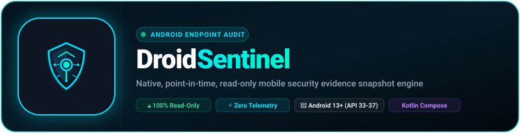

<p align="center">
  <a href="https://www.fullstopsolution.in">
    
  </a>
</p>

<p align="center">
  <a href="mailto:contact@fullstopsolution.in" style="font-weight:700; color:#38bdf8; text-decoration:none;">
    ✉️ Official Inquiries & Support Desk: <strong>contact@fullstopsolution.in</strong>
  </a>
</p>

<p align="center">
  
</p>

<p align="center">
  <a href="https://www.fullstopsolution.in"></a>
  <a href="https://github.com/iamkuruphere-sudo/DroidSentinel/releases/latest"></a>
  <a href="https://github.com/iamkuruphere-sudo/DroidSentinel/releases/latest"></a>
  <a href="https://www.fullstopsolution.in/security.html"></a>
  <a href="mailto:contact@fullstopsolution.in"></a>
</p>

# DroidSentinel

Part of the **[Fullstop Solution](https://www.fullstopsolution.in)** precision software ecosystem.

An enterprise-grade, point-in-time, read-only Android mobile endpoint security auditing and evidence collection app. Built natively in Kotlin with Jetpack Compose & Material 3.

DroidSentinel is the Android mobile companion to [MacSentinel](https://github.com/iamkuruphere-sudo/MacSentinel). It evaluates on-device security posture, firmware integrity, root/exploit indicators, sideloaded applications, dangerous permission clusters, storage threats (VBA macros & rogue update APKs), network posture, and phishing vectors without transmitting telemetry or customer data to third-party cloud servers.

---

## ⬇️ Official Downloads & Release Assets

| Resource | Value / Link |
| :--- | :--- |
| 🌐 **Official Ecosystem** | [Fullstop Solution Web & Desktop Suites](https://www.fullstopsolution.in) |
| 🤖 **Release APK** | [`DroidSentinel-release.apk`](https://github.com/iamkuruphere-sudo/DroidSentinel/releases/latest) (v1.0.0) |
| 📦 **Package ID** | `com.fullstopsolution.droidsentinel` |
| 🎯 **Target SDK** | Android 17 (API 37) / Min SDK: Android 13 (API 33) |
| 🔑 **Signing Fingerprint (SHA-256)** | `40:83:42:03:B8:15:A4:3E:70:78:2F:E1:6D:10:BC:DD:84:28:C3:C4:A8:7A:54:83:4D:42:97:B3:91:22:99:30` |
| 🛡️ **APK Binary Checksum (SHA-256)** | `524fa92317be85a649302454f0c03a178f8669a8a183186106ceded6b387b98c` |
| 📦 **GitHub Releases** | [DroidSentinel Releases](https://github.com/iamkuruphere-sudo/DroidSentinel/releases) |
| 🍏 **macOS Companion** | [MacSentinel](https://github.com/iamkuruphere-sudo/MacSentinel) |
| ✉️ **Official Support Desk** | [contact@fullstopsolution.in](mailto:contact@fullstopsolution.in) |

---

## Checks Included

### 1. OS & Firmware Integrity Posture
* **Multi-Vector Root Detection**: Scans 25+ known superuser execution paths (`/sbin/su`, `/system/bin/su`, `/data/adb/ksu`, `/data/adb/magisk`, `/data/adb/apd`, etc.), checks `su` binary execution in local environment, audits Magisk/KernelSU/APatch package presence, inspects `/proc/mounts` overlay isolation, and verifies kernel version string signatures.
* **Dynamic Hooking Framework Detection**: Detects LSPosed / Xposed runtime hooks and active class instrumentation.
* **SELinux Enforcement**: Queries kernel status via `getenforce` and `/sys/fs/selinux/enforce` to ensure SELinux is operating in mandatory `Enforcing` mode rather than `Permissive` or `Disabled`.
* **Build Integrity**: Analyzes OS build signature tags for developer or custom ROM `test-keys` and dangerous `ro.debuggable` / `ro.secure` system properties.
* **Debug Interfaces**: Audits USB Debugging (`ADB_ENABLED`) and Wireless ADB state over local Wi-Fi.
* **Hardware Keystore & StrongBox**: Cryptographically probes physical secure hardware element (StrongBox HSM / TEE) via ephemeral key generation.
* **Biometric & Keyguard Security**: Evaluates strong biometric hardware enrollment and screen lock authentication (Biometrics, PIN, Password).

### 2. Application & Sideload Auditing
* **Sideload Origin Tracking**: Differentiates official store installs (Google Play, Samsung Galaxy Store, Amazon Appstore, F-Droid, GetApps, AppGallery) from unverified sideloads (web browsers, file managers, local droppers).
* **High-Risk Permission Clustering**:
  * Screen Overlay / Tapjacking: `SYSTEM_ALERT_WINDOW`
  * Keystroke & Content Scraping: `BIND_ACCESSIBILITY_SERVICE`
  * OTP / SMS Exfiltration Pattern: `READ_SMS` / `RECEIVE_SMS` + `INTERNET`
  * Audio Surveillance Profile: `RECORD_AUDIO` + `INTERNET`
  * Camera Surveillance Profile: `CAMERA` + `INTERNET`
  * Dropper / Secondary Payload Execution: `REQUEST_INSTALL_PACKAGES`
* **Cleartext Network Traffic**: Identifies applications permitting unencrypted HTTP communication (`FLAG_USES_CLEARTEXT_TRAFFIC`).
* **IPC Attack Surface Analysis**: Scans application components for unprotected exported activities, services, and receivers (`exported=true` without permission gates).
* **Social Engineering Detection**: Identifies rogue packages masquerading as system or carrier updates (`system update`, `security patch`, `oneui update`).
* **Debuggable Production Apps**: Detects third-party apps compiled with `android:debuggable="true"`.
* **Target SDK Deprecation**: Flags applications targeting obsolete Android runtimes to evade modern runtime permission constraints.

### 3. Storage & Download Threat Inspection
* **OpenXML Macro Analysis**: Performs ZIP inspection of Word, Excel, and PowerPoint documents (`.docm`, `.xlsm`, `.pptm`, etc.) to isolate weaponized `vbaProject.bin` or `vbaData.xml` macros.
* **Script & Autorun Vectors**: Flags dangerous executable scripts (`.vbs`, `.bat`, `.cmd`, `.ps1`, `.sh`, `.dex`, `autorun.inf`).
* **Deceptive Double Extensions**: Detects masquerading payloads (`.pdf.apk`, `.jpg.apk`, `.doc.apk`, `.docx.apk`).
* **Unverified Standalone APKs**: Inspects downloaded installation packages for archive integrity, package names, and computes cryptographic SHA-256 hashes.

### 4. Network & Link Phishing Defense
* **Transport Encryption**: Audits Wi-Fi encryption status, active VPN tunnels (`TRANSPORT_VPN`), and captive portal interception.
* **Private DNS (DNS-over-TLS)**: Detects whether device DNS queries are protected against ISP/LAN eavesdropping and reports active DoT provider specifiers.
* **Interactive Phishing Heuristic Engine (10 Vectors)**:
  * Insecure HTTP cleartext warnings.
  * Deceptive `@` redirect syntax detection (`https://bank.com@phish.xyz`).
  * Raw numeric IPv4/IPv6 hostname detection (`http://192.168.1.1`).
  * Obfuscated hexadecimal and integer IP hosts (`http://0x7f000001`).
  * Non-standard phishing proxy ports (`:8080`, `:8888`, `:4444`).
  * Punycode / IDN homograph attack vectors (`xn--`).
  * Confusable mixed-script Cyrillic homoglyph detection (e.g. Cyrillic lookalikes `а`, `е`, `о`).
  * URL shortener expansion flags (`bit.ly`, `tinyurl.com`, `t.co`, etc.).
  * Suspicious TLD detection (`.top`, `.xyz`, `.buzz`, `.click`, etc.).
  * Brand spoofing subdomain analysis (`paypal.com.account-verify.xyz`).

### 5. Usability, Controls & Remediation
* **Interactive Animated Security Gauge**: Fluid sweep arc with status-dependent gradients, pulsing sonar animation, and dynamic score counter (0–100).
* **Real-Time Scan Controls**: Live progress indicator with stage-by-stage detail, ability to Pause/Resume, or Cancel scanning at any time.
* **Quick Remediation Hub**: One-tap direct action buttons linking directly to Android Settings (Developer Options, Screen Lock, Private DNS, Biometrics, App Info, Uninstall).
* **Multi-Format Evidence Sharing**: Exports full machine-readable JSON, executive Markdown compliance reports, and instant one-click clipboard summaries.
* **Real-Time Sideload Monitoring**: Background `InstallMonitorReceiver` dynamically alerts the user when a newly installed application holds privileged overlay or accessibility permissions or arrives from an unverified sideload origin.

---

## Technical Architecture

```
com.fullstopsolution.droidsentinel/
├── MainActivity.kt                      # Edge-to-edge Compose host & coroutine lifecycle
├── auditor/
│   ├── IntegrityAuditor.kt             # Kernel, Root, SELinux & Keystore checks
│   ├── AppThreatAuditor.kt             # Package inventory, sideload & permission clusters
│   ├── StorageInspector.kt             # Scoped storage, VBA macro & script inspection
│   └── NetworkAuditor.kt               # VPN, Private DNS & link phishing heuristic engine
├── receiver/
│   └── InstallMonitorReceiver.kt       # Real-time package installation security broadcast
├── export/
│   └── EvidenceExporter.kt             # Fullstop Solution standard JSON evidence generation
├── model/
│   └── SecurityModels.kt               # Structured findings, severity & assessment schema
└── ui/
    ├── screens/
    │   ├── DashboardScreen.kt          # Health gauge (0-100), quick stats & findings
    │   └── DetailTabs.kt               # Categorized Integrity, Apps, Storage & Network tabs
    └── theme/                          # Cyber Obsidian & Electric Cyan Material 3 Theme
```

---

## Building from Source

### Prerequisites
* JDK 17+ or OpenJDK 25 (e.g. bundled in Android Studio)
* Android SDK Platform 37 & Build-Tools 36.0.0+

### Build Commands
```bash
# Clone the repository
git clone https://github.com/iamkuruphere-sudo/DroidSentinel.git
cd DroidSentinel

# Build debug APK
./gradlew assembleDebug

# Build and sign release APK
./gradlew assembleRelease
```

The signed release APK will be generated at:
`app/build/outputs/apk/release/app-release.apk`

---

## Boundaries & Limitations

* Standard Android user-space security apps operate within the Linux application sandbox (`UID`). They cannot inspect the private sandboxed data directories of other apps or read raw hardware partitions.
* DroidSentinel collects evidence, not verdicts. Legitimate enterprise or developer software may utilize ADB debugging, sideloading, or background services.
* For hardware Knox attestation and verified boot flags, ensure Samsung Knox and Google Play Protect remain enabled.

---

## 🔒 Zero Telemetry Guarantee

100% on-device client execution. DroidSentinel contains zero analytics SDKs, zero advertising identifiers, zero tracking beacons, and zero outbound network transmission. All evidence reports remain strictly local until explicitly exported by the user.

---

## 📬 Official Support & Inquiries

For technical support, licensing, or confidential security disclosures:
* ✉️ **Email Desk:** [contact@fullstopsolution.in](mailto:contact@fullstopsolution.in)
* 🌐 **Web Portal:** [https://www.fullstopsolution.in](https://www.fullstopsolution.in)
* 🛡️ **Zero-Knowledge Security Architecture:** [https://www.fullstopsolution.in/security.html](https://www.fullstopsolution.in/security.html)

© 2026 [Fullstop Solution](https://www.fullstopsolution.in). All rights reserved.
